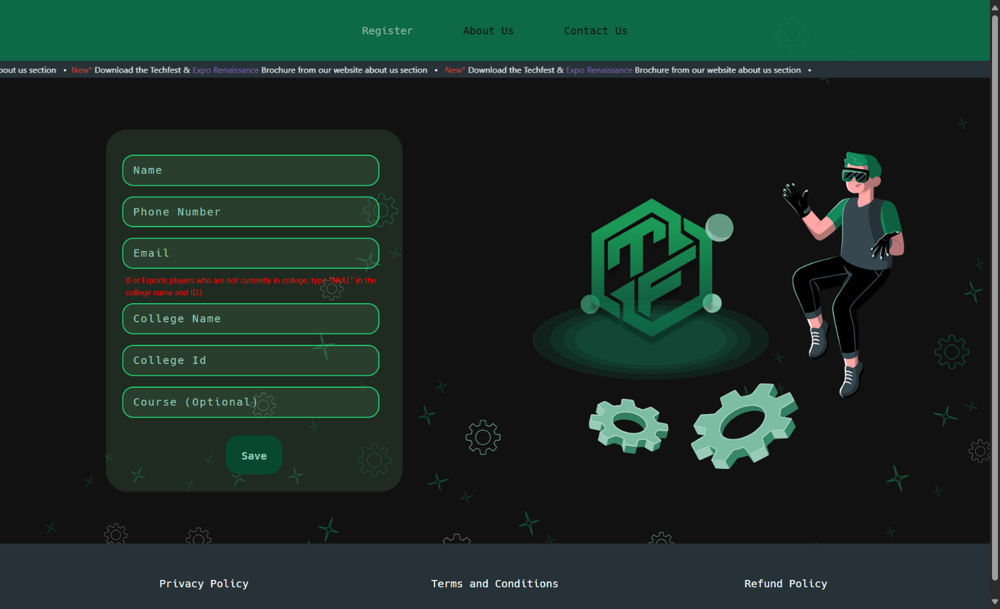
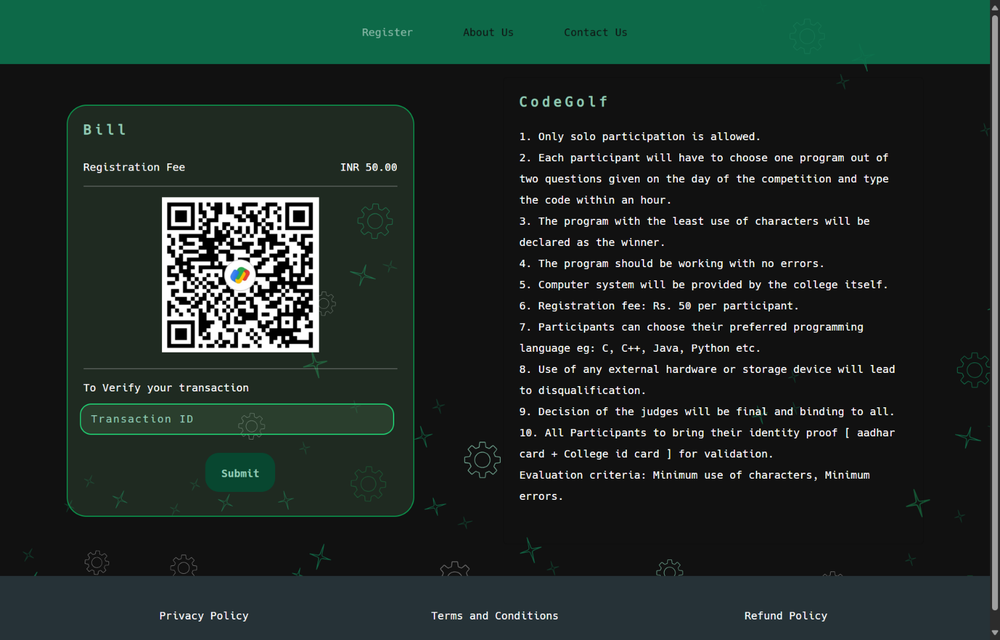
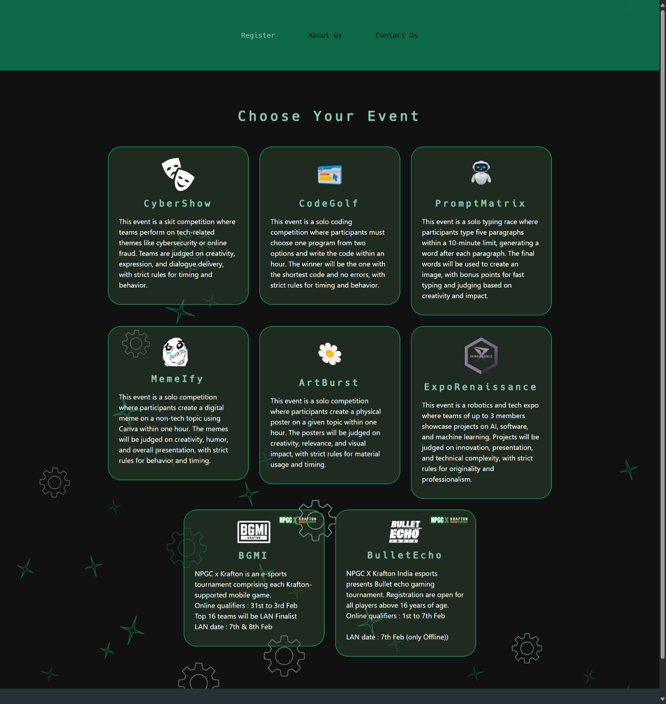

# TechFest Registration Website

A Django-based student registration website for a college techfest. It was built as an alternative to a basic form so students could enter their details, choose an event, review payment information, and access an admit-card flow.

## Features

- Student registration
- Event selection
- Manual payment summary
- Admit-card flow after the payment step
- Responsive frontend with HTML, CSS, JavaScript, and Bootstrap

The project was developed with a team. My contribution was on the frontend and registration experience. The project README and screenshots describe the intended flow; the old deployment and database state should not be assumed to be live.

## Screenshots

### Student registration


### Payment summary


### Event selection


## Tech stack

- **Frontend:** HTML, CSS, JavaScript, Bootstrap
- **Backend:** Django
- **Database:** SQLite for local development

## Run locally

Requirements: Python 3.8 or newer and pip.

```bash
git clone https://github.com/pandeynikhilone/TechFestEvent.git
cd TechFestEvent
python -m venv .venv
```

Activate the environment:

- Windows: `.venv\\Scripts\\activate`
- macOS/Linux: `source .venv/bin/activate`

Install dependencies and run Django migrations:

```bash
python -m pip install -r requirements.txt
python manage.py migrate
python manage.py runserver
```

Open [http://127.0.0.1:8000](http://127.0.0.1:8000).

A local database is created by Django when you run migrations. Do not commit a database containing real student registrations or personal data. The repository ignores local SQLite databases and environment files.

## Team

- **Frontend:** [Nikhil Pandey](https://github.com/pandeynikhilone)
- **Backend:** [Dev Athwani](https://github.com/devathwani1)

## Project status

This is a college project and is not presented as a currently operated public registration service. Payment and admit-card steps should be tested locally before relying on them.

[Source code](https://github.com/pandeynikhilone/TechFestEvent)
